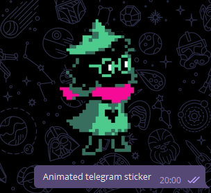

# pixelart2tgs

> [!WARNING]
> This project was fully merged into [tgradish](https://github.com/sliva0/tgradish),
> Which can do all the same things and more, better and faster.

Simple .gif to .tgs converter CLI utility.

## License

[MIT License](LICENSE.txt)
